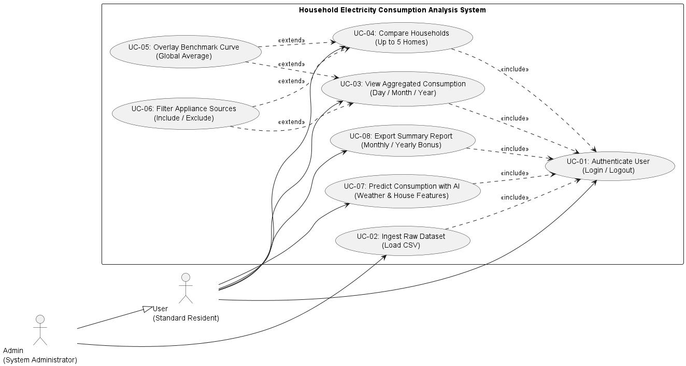

# Software Requirements Specification (SRS)

**Version:** 0.9 (Complete Draft)  
**Date:** 25/11/2026  
**Project:** Household Electricity Consumption Analysis Application  
**Authors:** [Member A Name], [Member B Name], [Member C Name]  

---

## Summary
1. Project Objectives
2. Main Features
3. Use Cases
4. Data Architecture
5. Interface Design
6. Project Constraints
7. Performance
8. Detailed Feature Specifications
9. Project Timeline & Milestones

---

## 1. Project Objectives

- **Define the Goal:** Design, implement, and validate a complete Python application that manages, analyzes, visualizes, and predicts electricity consumption across 500 anonymized European smart homes (100,000 measurement records).
- **Address the Need:** Provide household residents and system administrators with an intuitive, role-secured platform to monitor daily/monthly/yearly energy usage, benchmark consumption against all households, isolate appliance drivers, and explore weather-based load predictions.
- **Expected Benefits:**
  - Help residents identify high-consumption appliances (e.g., HVAC vs. Fridge) to reduce energy waste.
  - Give administrators centralized visibility across all 500 homes with rapid multi-household comparisons and exportable reports.
  - Ensure software reliability through V-Model traceability (FR <-> UC <-> TC).

---

## 2. Main Features

High-level system capabilities (without technical implementation details):

- **FR-01 — User Authentication & Role-Based Access (UC-01):** Secure username/password login and logout distinguishing User accounts (restricted to assigned households) and Admin accounts (access to all 500 households).
- **FR-02 — Raw Dataset Ingestion (UC-02):** Admin-only loading of raw electricity consumption records into structured storage while preserving all original values unaltered.
- **FR-03 — Periodic Consumption Visualization (UC-03):** Display daily electricity consumption by default for a selected household, with seamless switching to monthly and yearly aggregations.
- **FR-04 — Multi-Household Comparison (UC-04):** Compare up to 5 authorized households simultaneously on the same chart, each represented by a distinct color.
- **FR-05 — Global Benchmark Overlay (UC-05):** Overlay the average consumption curve (per day, month, or year) across all 500 households onto the selected household visualization.
- **FR-06 — Appliance Source Filtering (UC-06):** Filter visualizations by including or excluding specific appliance categories (e.g., displaying total consumption excluding refrigerators).
- **FR-07 — AI Consumption Prediction (UC-07):** Predict electricity consumption from forecast outdoor temperature and household characteristics using models trained on the provided dataset (with data cleaning isolated strictly within the AI training pipeline).
- **FR-08 — Summary Report Export [Bonus] (UC-08):** Export downloadable monthly and yearly summary reports containing total and per-resident consumption for selected households.

---

## 3. Use Cases

### 3.1 System Actors
- **User (Standard Resident):** Authenticated resident linked to one or more specific households; restricted to viewing, comparing, predicting, and exporting their own assigned homes (plus viewing the anonymized all-households benchmark curve).
- **Admin (System Administrator):** Inherits all User capabilities (Admin ▷ User), has access to all 500 households, and holds exclusive permission to ingest/reload raw datasets (UC-02).

### 3.2 Role-Based Access Control (RBAC) Matrix

| Feature / Use Case              |      User      |      Admin      | Access Rule                                        |
| :------------------------------ | :------------: | :-------------: | :------------------------------------------------- |
| Login / Logout (UC-01)          |    Allowed     |     Allowed     | Authenticated session required for all features    |
| Ingest Raw Dataset (UC-02)      |     Denied     |     Allowed     | Admin-only; hidden and blocked for User            |
| View Consumption (UC-03)        | Assigned Homes |  All 500 Homes  | Unauthorized home_id blocked on backend            |
| Compare Households, 2–5 (UC-04) | Assigned Homes |  Any 2–5 Homes  | Hard cap of 5 simultaneous households              |
| Overlay Global Average (UC-05)  |    Allowed     |     Allowed     | Anonymized global mean; exposes no private records |
| Filter Appliances (UC-06)       |    Allowed     |     Allowed     | Applied dynamically in memory                      |
| AI Prediction (UC-07)           | Assigned Homes |  All 500 Homes  | In-memory cleaning isolated to AI pipeline only    |
| Export Summary Report (UC-08)   | Assigned Homes | All / Any Homes | Restricted to authorized households                |

### 3.3 Use Case Diagram



*(Insert docs/diagrams/use_case_diagram.png directly into Section 3 of the Word SRS template.)*

---

## 4. Data Architecture

*Main entities and attributes stored by the system (conceptual level, without technical data types or database constraints per SRS template guidelines):*

- **Users:** users_id, users_name, password_hash, role
- **Households:** home_id
- **User_Households:** user_households_id, users_id, home_id
- **Appliances:** appliance_id, appliance_name
- **Measurements:** measurement_id, home_id, appliance_id, energy_consumption, time, date, outdoor_temperature, season, household_size

---

## 5. Interface Design

*Note: Replace the wireframe blueprints below with final application screenshots (Login Screen + Main Analytics Dashboard) once UI integration is complete.*

### Screen 1: Login Screen (`UC-01`)

```text
+------------------------------------------------------------------------+
|                  ⚡ Household Electricity Analysis                      |
|                       European Smart Home Portal                       |
+------------------------------------------------------------------------+
|                                                                        |
|                    +------------------------------+                    |
|                    |        Sign In               |                    |
|                    |                              |                    |
|                    |  Username                    |                    |
|                    |  [ ________________________ ]|                    |
|                    |                              |                    |
|                    |  Password                    |                    |
|                    |  [ •••••••••••••••••••••••• ]|                    |
|                    |                              |                    |
|                    |  [         Login          ]  |                    |
|                    |                              |                    |
|                    |  (Error banner if invalid)   |                    |
|                    +------------------------------+                    |
|                                                                        |
+------------------------------------------------------------------------+
```

**Design Guidelines:**
- Centered card layout, clean white/light-grey background, high-contrast primary action button.
- Password input masked by default; inline validation error displayed below the button without crashing or exposing whether the username exists.

---

### Screen 2: Main Dashboard, Comparison & AI Prediction (`UC-02`–`UC-08`)

```text
+------------------------------------------------------------------------+
| ⚡ Household Electricity Analysis   | Logged in as: admin (Admin) [Logout] |
+--------------------+---------------------------------------------------+
|   SIDEBAR CONTROLS |  [ 📊 Analytics & Compare ] [ 🤖 AI Predict ]     |
|                    |  [ 📄 Export Report ]  [ ⚙️ Admin Data (Admin) ]  |
|  1. Households     +---------------------------------------------------+
|  [ Home_001   x ]  |  KPI Row:                                         |
|  [ Home_012   x ]  |  [ Total: 1,245 kWh ] [ Avg/Day: 3.4 kWh ]        |
|  (+ up to 5 max)   |  [ Peak Date: 2023-07-18 ] [ Selected: 2 Homes ]  |
|                    +---------------------------------------------------+
|  2. Granularity    |                                                   |
|  (•) Daily         |     Consumption Over Time (Daily, kWh)            |
|  ( ) Monthly       |   kWh ^                                           |
|  ( ) Yearly        |       |   /\    /\_  Home_001 (Blue)              |
|                    |       |  /  \  /   \ Home_012 (Orange)            |
|  3. Benchmark      |       | - - - - - -  All-Homes Avg (Dashed Black) |
|  [x] Show Global   |       +------------------------------------> Date |
|      Average Curve |                                                   |
|                    +---------------------------------------------------+
|  4. Appliance      |  Appliance Breakdown / Summary Table              |
|     Filter         |  +------------+-----------+-----------------+     |
|  [x] AC  [x] Heater|  | Home ID    | Total kWh | Per-Resident kWh|     |
|  [ ] Fridge        |  +------------+-----------+-----------------+     |
|  [x] Oven  ...     |  | Home_001   | 640.2     | 213.4           |     |
|  [Reset All]       |  +------------+-----------+-----------------+     |
+--------------------+---------------------------------------------------+
```

**Design Guidelines:**
- **Left Sidebar:** Persistent global filters (RBAC-filtered household multi-select capped at 5, Daily/Monthly/Yearly radio, Global Average checkbox, 10-appliance checkboxes).
- **Top Navigation Tabs:** Clean separation of **Analytics & Compare**, **AI Prediction**, **Export Report**, and **Admin Data** (hidden for `User` role).
- **Visual Clarity:** Colorblind-safe distinct palette for up to 5 homes + dashed black line for the global average curve.


---

## 6. Project Constraints

- **General & Technical Constraints:**
  - Web-based Python application compatible with modern desktop browsers (Google Chrome, Microsoft Edge) on 1920x1080 displays.
  - Persistent storage implemented with normalized relational CSV files (no external database server required) while enforcing Primary Key, Foreign Key, Unique, and Not Null integrity in code.
  - Codebase follows Python PEP 8 standards, modular separation of concerns, and English documentation.
- **Compliance & Data Fidelity Constraints (NFR-02, NFR-03):**
  - **Anonymization & Privacy:** All 500 European smart homes are anonymized (home_id); horizontal RBAC prevents any User from accessing unassigned household data.
  - **Password Protection:** Credentials are never stored in plain text (cryptographic SHA-256 hashing with constant-time verification).
  - **Strict Raw Data Preservation:** All 100,000 raw records (including temperature anomalies and season-date inconsistencies) must remain unaltered in storage and standard visualizations. Data cleaning is strictly isolated inside the AI model training pipeline (UC-07).

---

## 7. Performance

- **Response Time (NFR-01):**
  - Authentication verification: <= 1.0 second.
  - Default daily/monthly/yearly chart aggregation & rendering across 100,000 records: <= 2.0 seconds.
  - Interactive appliance filter updates: <= 500 ms.
  - Summary report export generation (up to 500 households): <= 2.0 seconds.
- **Memory & Resource Constraints:**
  - Full 100,000-row dataset and trained AI baselines must run comfortably on standard student laptops (<= 500 MB application RAM footprint, no GPU required).
  - Trained AI models are cached in memory across user interactions to prevent redundant retraining.

---

## 8. Detailed Feature Specifications

*Each use case (UC-01 through UC-08) is specified below using the standard 11-field Documentation Slip format. Replace [Member A/B/C Name] with actual team member names before final submission.*

### UC-01: Authenticate User (`FR-01`)

| Field | Details |
| :--- | :--- |
| **Name** | `UC-01` - Authenticate User (Login / Logout) |
| **Author** | `[Member A Name]` |
| **Date** | 2026-11-23 |
| **Objective** | Allow a registered `User` or `Admin` to securely log in with username and password, establish a role-scoped session, and log out safely. |
| **Precondition** | The application is running; the `users.csv` credential file exists and is readable; the user is not currently authenticated. |
| **Postcondition** | On login: an authenticated session is created with the user's role (`User` or `Admin`) and authorized `Home ID` list, and the dashboard is displayed. On logout: the session is cleared and the login screen is shown. |
| **Invariant** | Unauthenticated visitors cannot access any consumption data, charts, predictions, or export features. |
| **Description** | Verifies user credentials against stored hashed passwords and binds the active session to the user's role and authorized households. |
| **Visible Actions** | `Va1`: User opens the application and sees the login form.<br>`Va2`: User enters username and password.<br>`Va3`: User clicks "Login".<br>`Va4`: System validates credentials and loads the role-appropriate dashboard with a welcome banner.<br>`Va5`: (Later) User clicks "Logout" and returns to the login form. |
| **Scenarios** | `Sc1` (Nominal): Valid username and password -> session initialized -> redirect to dashboard.<br>`ScA1` (Alternative): Authenticated user clicks "Logout" -> session cleared -> redirect to login screen.<br>`ScE1` (Error): Incorrect password -> display `"Invalid username or password"`, no session created.<br>`ScE2` (Error): Non-existent username -> display `"Invalid username or password"`, no session created.<br>`ScE3` (Error): Empty username or password field -> display `"Username and password are required"`. |
| **Business Rules** | `Br1`: Passwords must never be stored or logged in plain text (use salted hash, e.g., SHA-256 / PBKDF2).<br>`Br2`: `User` accounts are strictly restricted to their linked `Home ID`(s); `Admin` accounts receive access to all 500 households.<br>`Br3`: Login verification must complete within 1 second (`NFR-01`). |

---

### UC-02: Ingest Raw Dataset (`FR-02`)

| Field | Details |
| :--- | :--- |
| **Name** | `UC-02` - Ingest Raw Dataset (Load CSV) |
| **Author** | `[Member A Name]` |
| **Date** | 2026-11-23 |
| **Objective** | Allow an `Admin` to load the raw household electricity consumption CSV file into the normalized CSV data model while preserving all raw records unaltered. |
| **Precondition** | Actor is authenticated as `Admin` (`UC-01`); raw CSV file is available on disk or uploaded via the Admin panel. |
| **Postcondition** | Normalized relational CSV tables (`households.csv`, `appliances.csv`, `measurements.csv`) are generated/updated in `data/processed/` with Primary Key and Foreign Key integrity verified; ingestion summary (row count, homes count) is displayed. |
| **Invariant** | Raw values (including temperature fluctuations, seasonal contradictions, and per-row household size) are preserved 100% faithfully in storage (`NFR-02`). |
| **Description** | Parses the raw `cp1252`-encoded CSV file (100,000 rows, 500 European smart homes), validates required columns and key integrity, normalizes entities into linked CSV tables without dropping or altering inconsistent measurements, and writes them to `data/processed/`. |
| **Visible Actions** | `Va1`: Admin navigates to the "Data Management" section.<br>`Va2`: Admin selects/uploads the raw CSV file and clicks "Load Dataset".<br>`Va3`: System parses, validates schema, normalizes into relational CSV files, and shows a progress indicator.<br>`Va4`: System displays confirmation with total records loaded (100,000) and unique households (500). |
| **Scenarios** | `Sc1` (Nominal): Valid `cp1252` CSV with all 8 required columns -> normalized files written -> success summary shown.<br>`ScA1` (Alternative): Processed CSV files already exist -> Admin confirms reload -> existing normalized files are cleanly overwritten.<br>`ScE1` (Error): Non-Admin attempts to access ingestion -> access denied.<br>`ScE2` (Error): Missing required column(s) or corrupted file -> ingestion aborted, existing data preserved, error message displayed.<br>`ScE3` (Error): File not found or unreadable encoding -> graceful error message displayed. |
| **Business Rules** | `Br1`: Only `Admin` role can trigger data ingestion (`NFR-03`).<br>`Br2`: Parser must explicitly handle `cp1252` encoding (for the `"°"` character in `Outdoor Temperature (°C)`).<br>`Br3`: No raw rows may be dropped or overwritten during ingestion; cleaning is strictly prohibited before the AI module (`NFR-02`). |

---

### UC-03: View Aggregated Consumption (`FR-03`)

| Field | Details |
| :--- | :--- |
| **Name** | `UC-03` - View Aggregated Consumption (Day / Month / Year) |
| **Author** | `[Member B Name]` |
| **Date** | 2026-11-23 |
| **Objective** | Display electricity consumption time-series for a selected authorized household, defaulting to daily aggregation with interactive switching to monthly or yearly views. |
| **Precondition** | Actor is authenticated (`UC-01`); normalized dataset is loaded (`UC-02`); actor has at least one authorized `Home ID`. |
| **Postcondition** | A labeled consumption chart (total kWh over time) and key summary metrics (total kWh, daily average, peak date) are rendered for the chosen household and granularity. |
| **Invariant** | Displayed data strictly belongs to authorized `Home ID`(s) and reflects unaltered raw measurements (`NFR-02`, `NFR-03`). |
| **Description** | Aggregates `Energy Consumption (kWh)` by the chosen time granularity (`Daily` by default, `Monthly`, or `Yearly`) and optional date range, rendering a responsive Matplotlib/Seaborn chart. |
| **Visible Actions** | `Va1`: User lands on the Dashboard; system automatically loads the first authorized household in **Daily** view.<br>`Va2`: User selects another authorized `Home ID` (if multiple are available).<br>`Va3`: User switches aggregation granularity between `Daily`, `Monthly`, and `Yearly`.<br>`Va4`: System updates the chart and summary KPIs within 2 seconds. |
| **Scenarios** | `Sc1` (Nominal): Authorized household selected, default Daily view -> chart renders with daily kWh totals.<br>`ScA1` (Alternative): User switches to `Monthly` or `Yearly` -> x-axis and totals re-aggregate accordingly.<br>`ScA2` (Alternative): User narrows the date range -> chart zooms to selected dates.<br>`ScE1` (Error): `User` attempts to query an unassigned `Home ID` -> backend blocks request and displays `"Access denied"`.<br>`ScE2` (Error): No records exist for the selected date range -> display `"No consumption data available for the selected filters"`. |
| **Business Rules** | `Br1`: Default granularity upon dashboard load MUST be **Daily** (`FR-03`).<br>`Br2`: Rendering must complete within 2.0 seconds (`NFR-01`).<br>`Br3`: Chart must include clear axis labels (`Date / Period`, `Energy Consumption (kWh)`), title, and legend. |

---

### UC-04: Compare Households (`FR-04`)

| Field               | Details                                                                                                                                                                                                                                                                                                                                                                                                                                                                                                                                                                                              |
| :------------------ | :--------------------------------------------------------------------------------------------------------------------------------------------------------------------------------------------------------------------------------------------------------------------------------------------------------------------------------------------------------------------------------------------------------------------------------------------------------------------------------------------------------------------------------------------------------------------------------------------------- |
| **Name**            | `UC-04` - Compare Households (Up to 5 Homes)                                                                                                                                                                                                                                                                                                                                                                                                                                                                                                                                                         |
| **Author**          | `[Member B Name]`                                                                                                                                                                                                                                                                                                                                                                                                                                                                                                                                                                                    |
| **Date**            | 2026-11-23                                                                                                                                                                                                                                                                                                                                                                                                                                                                                                                                                                                           |
| **Objective**       | Enable simultaneous visual comparison of up to 5 authorized households on a single chart, each rendered in a distinct color.                                                                                                                                                                                                                                                                                                                                                                                                                                                                         |
| **Precondition**    | Actor is authenticated (`UC-01`); normalized dataset is loaded (`UC-02`); actor has access to at least 2 authorized households.                                                                                                                                                                                                                                                                                                                                                                                                                                                                      |
| **Postcondition**   | An overlaid multi-series chart displays the selected households (2 to 5) with a distinct color per household and a clear legend.                                                                                                                                                                                                                                                                                                                                                                                                                                                                     |
| **Invariant**       | Maximum 5 households may be compared simultaneously; every compared household must pass RBAC authorization (`NFR-03`).                                                                                                                                                                                                                                                                                                                                                                                                                                                                               |
| **Description**     | Allows `Admin` (from all 500 homes) or multi-home `User` (from their assigned homes) to select between 2 and 5 households and compare their daily, monthly, or yearly consumption curves side by side.                                                                                                                                                                                                                                                                                                                                                                                               |
| **Visible Actions** | `Va1`: User opens the household multi-selector control.<br>`Va2`: User selects 2 to 5 authorized `Home ID`s.<br>`Va3`: User chooses granularity (`Daily` / `Monthly` / `Yearly`).<br>`Va4`: System plots each household's curve in a unique, high-contrast color with a matching legend.                                                                                                                                                                                                                                                                                                             |
| **Scenarios**       | `Sc1` (Nominal): User selects 3 authorized households -> 3 distinct colored curves rendered on shared axes.<br>`ScA1` (Alternative): User removes one household -> chart updates immediately to 2 curves.<br>`ScE1` (Error): User attempts to select a 6th household -> UI prevents selection and displays `"Maximum 5 households can be compared simultaneously"`.<br>`ScE2` (Error): A `User` linked to only 1 household opens comparison -> info message explains only 1 household is assigned.<br>`ScE3` (Error): Unauthorized `Home ID` injected in request -> backend raises permission error. |
| **Business Rules**  | `Br1`: Hard upper limit of 5 simultaneous households (`FR-04`).<br>`Br2`: Distinct colorblind-friendly palette must be used so no two households share the same color.<br>`Br3`: Works seamlessly with `UC-05` (global average overlay) and `UC-06` (appliance filter).                                                                                                                                                                                                                                                                                                                              |

---

### UC-05: Overlay Benchmark Curve (`FR-05`)

| Field | Details |
| :--- | :--- |
| **Name** | `UC-05` - Overlay Global Average Benchmark Curve |
| **Author** | `[Member B Name]` |
| **Date** | 2026-11-23 |
| **Objective** | Overlay the average electricity consumption curve (per day, month, or year) across all 500 households onto the active household chart. |
| **Precondition** | Actor is viewing a valid consumption or comparison chart (`UC-03` or `UC-04`). |
| **Postcondition** | A visually distinct benchmark line (e.g., dashed black/grey line labeled `"All-Households Average"`) is overlaid on the existing chart at matching time granularity. |
| **Invariant** | The benchmark curve reflects the anonymized mean across all households and exposes no individual data of other residents (`NFR-03`). |
| **Description** | Computes the mean per-household consumption across all 500 homes for each day, month, or year (respecting active appliance filters when applicable) and plots it over the selected household series. |
| **Visible Actions** | `Va1`: User toggles the "Show Global Average Curve" checkbox on.<br>`Va2`: System computes (or retrieves cached) all-household mean for the active granularity.<br>`Va3`: Chart refreshes with the dashed average curve overlaid and added to the legend. |
| **Scenarios** | `Sc1` (Nominal): User enables overlay on Daily view -> dashed global average curve appears over selected home(s).<br>`ScA1` (Alternative): User switches from Daily to Monthly while overlay is active -> benchmark curve automatically recalculates at Monthly granularity.<br>`ScA2` (Alternative): User toggles overlay off -> benchmark curve disappears.<br>`ScE1` (Error): All appliances are excluded via `UC-06` -> no curve plotted, empty-filter warning shown. |
| **Business Rules** | `Br1`: Global average is computed as `sum(kWh across all homes in period) / number_of_active_homes_in_period` (mean per household, not raw total).<br>`Br2`: Visually differentiated from household curves (e.g., dashed line style) so it cannot be confused with an individual home.<br>`Br3`: Accessible to both `User` and `Admin` roles. |

---

### UC-06: Filter Appliance Sources (`FR-06`)

| Field | Details |
| :--- | :--- |
| **Name** | `UC-06` - Filter Appliance Sources |
| **Author** | `[Member B Name]` |
| **Date** | 2026-11-23 |
| **Objective** | Allow users to filter electricity consumption by including or excluding specific appliance types (e.g., excluding Refrigerators) across visualizations. |
| **Precondition** | Actor is viewing `UC-03` or `UC-04`; the 10 appliance types are loaded from `appliances.csv`. |
| **Postcondition** | The consumption chart, KPI totals, and (if active) global average curve update to reflect only the selected appliance types. |
| **Invariant** | Filtering operates on in-memory query views only and never modifies underlying stored CSV files (`NFR-02`). |
| **Description** | Provides a multi-select or checkbox filter over all 10 appliance categories (Air Conditioning, Heater, Fridge, Oven, Microwave, Washing Machine, Dishwasher, TV, Computer, Lights), supporting quick "Select All" and "Exclude Fridge" workflows. |
| **Visible Actions** | `Va1`: User views the Appliance Filter panel (all 10 appliances selected by default).<br>`Va2`: User unchecks one or more appliances (e.g., `Fridge`).<br>`Va3`: System recomputes aggregated kWh excluding unchecked appliances and redraws the chart within 500 ms. |
| **Scenarios** | `Sc1` (Nominal): User unchecks `Fridge` -> chart re-renders showing total consumption excluding refrigerators.<br>`ScA1` (Alternative): User selects only `Air Conditioning` and `Heater` -> chart isolates HVAC consumption.<br>`ScA2` (Alternative): User clicks "Reset / Select All" -> full consumption restored.<br>`ScE1` (Error): User deselects all appliances -> system displays `"Please select at least one appliance type"` instead of crashing. |
| **Business Rules** | `Br1`: All 10 appliance types are included by default.<br>`Br2`: Filter re-render latency must be under 500 ms (`NFR-01`).<br>`Br3`: When `UC-05` (Global Average) is active, the same appliance filter is applied to the benchmark for apples-to-apples comparison. |

---

### UC-07: Predict Consumption with AI (`FR-07`)

| Field | Details |
| :--- | :--- |
| **Name** | `UC-07` - Predict Electricity Consumption with AI |
| **Author** | `[Member C Name]` |
| **Date** | 2026-11-23 |
| **Objective** | Train predictive baseline models on the dataset (with cleaning isolated inside the ML pipeline) and predict electricity consumption given forecast outdoor temperature and household characteristics. |
| **Precondition** | Actor is authenticated (`UC-01`); normalized dataset is loaded (`UC-02`); actor selects an authorized `Home ID` or valid house characteristics. |
| **Postcondition** | Predicted consumption (kWh) is displayed alongside transparent model evaluation metrics (`R²`, `MAE`, `RMSE`) for both baselines (Statsmodels OLS and Scikit-learn Tree/Ensemble model). |
| **Invariant** | Any data cleaning performed for model training occurs strictly on an in-memory copy inside the ML module and NEVER alters the persisted CSV files (`NFR-02`). |
| **Description** | Cleans a training copy of the dataset inside `prediction_service.py` (e.g., deriving consistent Season from Date, handling per-home Household Size summary, optional outlier checks), trains two baseline models (Statsmodels OLS + Scikit-learn Random Forest / Gradient Boosting), evaluates them on a hold-out test split, and runs inference for user-supplied forecast temperature, season, household size, and appliance/scope. |
| **Visible Actions** | `Va1`: User opens the "AI Prediction" tab.<br>`Va2`: User selects an authorized household (auto-filling its characteristics) or enters forecast `Outdoor Temperature (°C)`, `Household Size`, `Season`, and optional `Appliance Type`.<br>`Va3`: User selects model (Statsmodels OLS or Scikit-learn baseline) and clicks "Predict".<br>`Va4`: System displays predicted kWh, model performance metrics (`R²`, `MAE`, `RMSE`), and a diagnostic note on weather-consumption correlation. |
| **Scenarios** | `Sc1` (Nominal): User enters `Outdoor Temperature = 28.0°C`, `Household Size = 3`, `Season = Summer` -> system outputs predicted kWh and test metrics.<br>`ScA1` (Alternative): User switches between Statsmodels OLS and Scikit-learn model -> predictions and metrics update for comparison.<br>`ScE1` (Error): Out-of-range temperature (e.g., `-100°C` or `100°C`) or non-positive household size (`0` or `-2`) -> validation error displayed, no prediction run.<br>`ScE2` (Error): Model training fails due to missing dataset -> clear error message shown. |
| **Business Rules** | `Br1`: Data cleaning is strictly isolated inside the ML training pipeline (`NFR-02`).<br>`Br2`: Model metrics (`R²`, `MAE`, `RMSE`) must be reported honestly on a train/test split; if weather-to-energy correlation is near zero, the UI must transparently report low predictive power rather than fabricating high accuracy.<br>`Br3`: Must include a `Statsmodels` model to fulfill course prerequisites (`Project_Subject PAGE 1`). |

---

### UC-08: Export Summary Report (`FR-08` - Bonus)

| Field | Details |
| :--- | :--- |
| **Name** | `UC-08` - Export Summary Report (Bonus) |
| **Author** | `[Member C Name]` |
| **Date** | 2026-11-23 |
| **Objective** | Generate and download a monthly and yearly summary report containing total and per-resident electricity consumption for selected authorized households. |
| **Precondition** | Actor is authenticated (`UC-01`); normalized dataset is loaded (`UC-02`); at least one authorized household is selected. |
| **Postcondition** | A structured summary report file (`.csv`) is generated and downloaded to the user's machine with columns for Household, Period (Month/Year), Total Consumption (kWh), Reference Household Size, and Per-Resident Consumption (kWh/person). |
| **Invariant** | Exported report contains only households authorized for the active user (`NFR-03`) and is computed from unaltered stored records (`NFR-02`). |
| **Description** | Aggregates monthly and yearly total consumption for the selected authorized household(s), computes per-resident consumption using a documented household-size rule (mean/latest recorded household size for that period), previews the summary table on screen, and provides a one-click file download. |
| **Visible Actions** | `Va1`: User navigates to the "Export Report" section.<br>`Va2`: User selects one or more authorized households and report period (`Monthly`, `Yearly`, or `Both`).<br>`Va3`: User clicks "Generate Preview".<br>`Va4`: System displays the summary table preview.<br>`Va5`: User clicks "Download CSV Report" and saves the file locally. |
| **Scenarios** | `Sc1` (Nominal): User selects 2 authorized homes and `Monthly` -> preview renders -> CSV downloads successfully.<br>`ScA1` (Alternative): Admin selects all 500 homes for a `Yearly` summary -> report generates and downloads within performance limits.<br>`ScE1` (Error): No household selected -> "Download" disabled with warning `"Select at least one household"`.<br>`ScE2` (Error): `User` attempts to export an unassigned household -> backend blocks export with permission error. |
| **Business Rules** | `Br1`: Per-resident consumption formula must be explicitly defined and documented (`Total kWh / Mean Household Size for that home & period`, preventing division by zero).<br>`Br2`: Exported CSV uses UTF-8 encoding with clear English column headers.<br>`Br3`: Export generation for up to 500 homes must complete within 2.0 seconds (`NFR-01`). |


---

## 9. Project Timeline & Milestones

Aligned with the official Technical Project V-Model schedule (1 - Informations, Page 5):

| Phase | Dates | Key Activities & Deliverables |
| :--- | :--- | :--- |
| **Phase 1: Launch, Specification & Design** | Mon Nov 23 – Tue Nov 24 | Requirements analysis, Use Case Diagram & Documentation Slips, Data Schema, Class & Database Diagrams, initial **SRS**, **SDD**, and **SVVP v0.1** |
| **Phase 2: Parallel Development** | Wed Nov 25 – Mon Nov 30 | Data layer & ETL (S6), Authentication & RBAC (S7), Visualization & Appliance Filtering (S8–S9), AI Dual-Baseline Prediction (S10), Bonus Summary Report Export (S11) |
| **Phase 3: Testing & Validation** | Tue Dec 01 – Wed Dec 02 | Automated pytest unit tests, execution of all 18 SVVP scenarios (OK/KO & success rate), finalization of **SRS**, **SDD**, **SVVP v1.0**, and **Personal Reports** |
| **Phase 4: Final Presentation** | Thu Dec 03 | Live application demonstration (3-minute core workflow) & technical Q&A |
